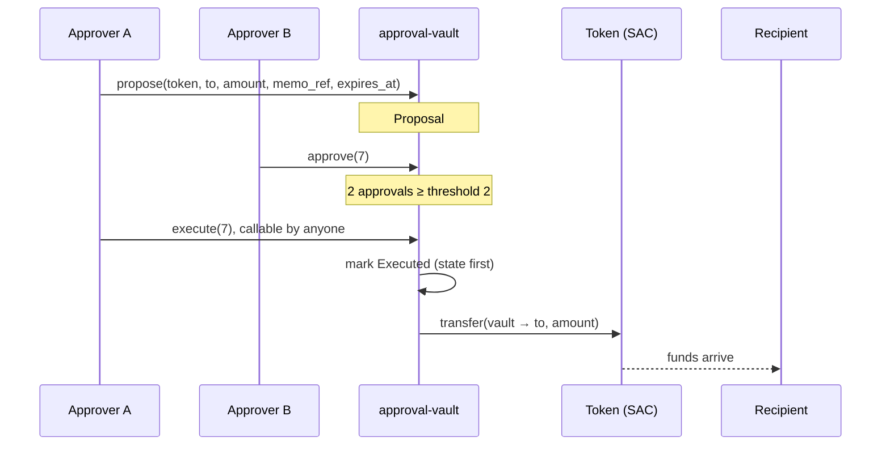
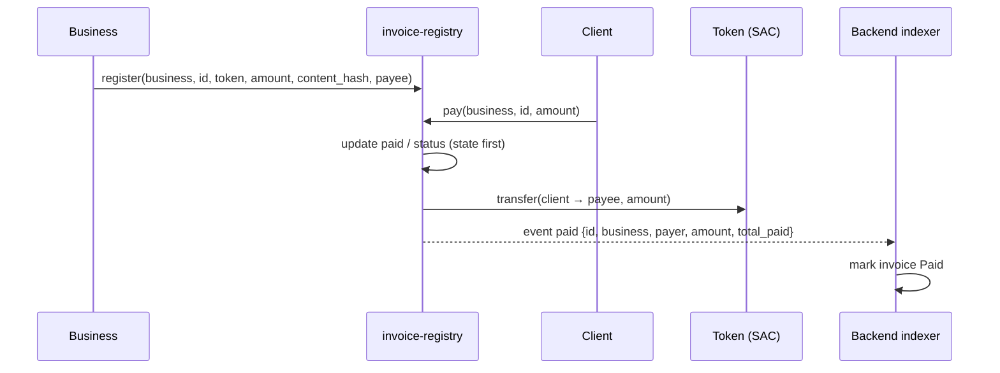
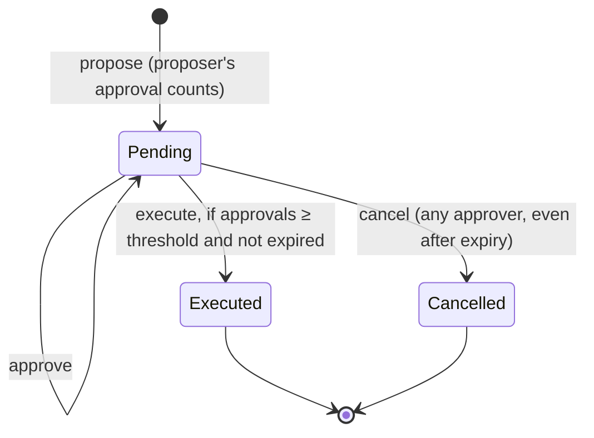
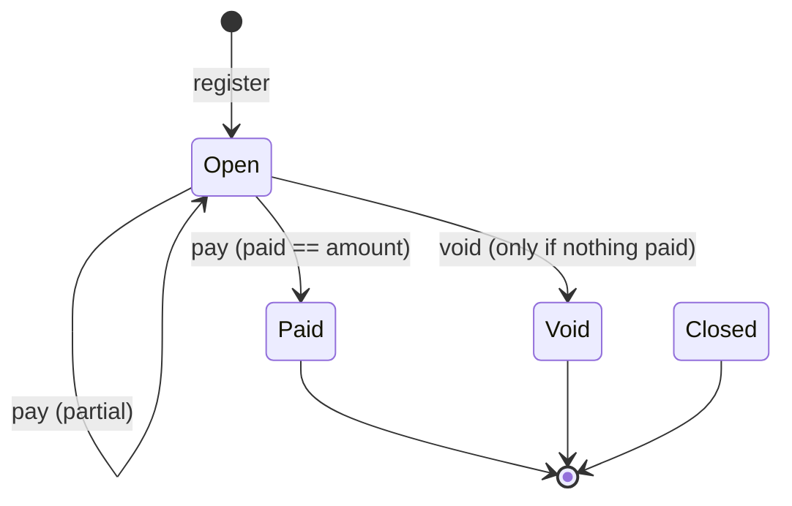

# Stellar Finance OS — Contracts

[](https://github.com/Stellar-Finance-OS/Stellar-Finance-OS-Contracts/actions/workflows/ci.yml)


Soroban smart contracts that add on-chain guarantees to **Stellar Finance OS**, a treasury and invoicing platform for businesses on Stellar.

| Contract | What it guarantees |
|---|---|
| **`approval-vault`** | Treasury funds leave only after **M-of-N approvers** sign off, enforced on-chain rather than by the backend. |
| **`invoice-registry`** | Clients pay invoices **through the contract**, so every payment carries an event that names the exact invoice it settles. |

> [!IMPORTANT]
> **Phase 2, testnet only.** The MVP runs on plain Stellar payments with off-chain approvals in the backend. These contracts layer on top once there are pilot users. They have **not been audited** and must not be deployed to mainnet until they are (see [§5](#5-security)).

**Part of a three-repo system:**

| Repo | Role |
|---|---|
| **Stellar-Finance-OS-Contracts** (this repo) | Soroban contracts, deployment records, generated TS bindings |
| [Stellar-Finance-OS-Backend](https://github.com/Stellar-Finance-OS/Stellar-Finance-OS-Backend) | API and the event indexer that mirrors contract state |
| [Stellar-Finance-OS-Web](https://github.com/Stellar-Finance-OS/Stellar-Finance-OS-Web) | Frontend and wallet integration |

## Contents

1. [How it works](#1-how-it-works)
2. [Getting started](#2-getting-started)
3. [Contract: `approval-vault`](#3-contract-approval-vault)
4. [Contract: `invoice-registry`](#4-contract-invoice-registry)
5. [Security](#5-security)
6. [Deploying](#6-deploying)
7. [Using this repo from the backend and web](#7-using-this-repo-from-the-backend-and-web)
8. [Development](#8-development)
9. [Project status](#9-project-status)

---

## 1. How it works

### Paying out from the treasury (`approval-vault`)

The vault holds the organisation's tokens, such as USDC via its Stellar Asset Contract. Any approver can propose a payment, and it executes only once enough approvers agree.



`memo_ref` is a hash of the backend's `PaymentRequest` id. It links the on-chain proposal to the off-chain record without putting business data on-chain.

### Getting paid (`invoice-registry`)

The business registers an invoice by its hash. The client pays through the contract, which forwards the funds to the invoice's `payee` (the business itself, or e.g. its `approval-vault`) and emits a `paid` event naming the invoice. The backend indexer uses that event to mark the invoice paid. No guessing from memos or amounts.



Only hashes and the payable amount go on-chain. **Never put customer names, descriptions or other personal data on-chain.**

---

## 2. Getting started

### Prerequisites

| Tool | Version | Notes |
|---|---|---|
| Rust | **1.99.1** (pinned) | `rust-toolchain.toml` pins it and installs the `wasm32v1-none` target, `rustfmt` and `clippy`. Pinned for reproducible Wasm |
| [Stellar CLI](https://developers.stellar.org/docs/tools/cli) | **≥ 25.2** (CI uses 28.1.0) | Needed to build Wasm, deploy, and generate bindings. Not needed for tests |
| `jq` | any | Used by `deploy.sh` |
| `cargo-llvm-cov` | optional | Only for `./scripts/coverage.sh` |

> [!NOTE]
> Building the Stellar CLI from source needs about 8 GB of RAM. On small machines, install a [prebuilt release](https://github.com/stellar/stellar-cli/releases) or deploy through the GitHub workflow (see [§6](#6-deploying)).

### Run the tests

```bash
git clone https://github.com/Stellar-Finance-OS/Stellar-Finance-OS-Contracts.git
cd Stellar-Finance-OS-Contracts
./scripts/check.sh        # cargo fmt --check, clippy -D warnings, cargo test
```

### Build the contracts

```bash
./scripts/build.sh        # wraps `stellar contract build`
# → target/wasm32v1-none/release/approval_vault.wasm
# → target/wasm32v1-none/release/invoice_registry.wasm
```

> [!WARNING]
> soroban-sdk ≥ 29 deliberately refuses a plain `cargo build --target wasm32v1-none`. Always build through the Stellar CLI, which post-processes the contract spec. A raw cargo Wasm must never be deployed.

### Repository layout

```
├── contracts/
│   ├── approval-vault/src/     # lib.rs (entrypoints) · types.rs · storage.rs · events.rs · test.rs
│   └── invoice-registry/src/   # same layout
├── packages/common/            # shared TTL policy + amount validation
├── bindings/                   # generated TypeScript clients (do not edit)
├── deployments/                # <network>.json: contract ids + Wasm hashes
├── docs/                       # threat model, coverage, events, testnet runbook, build verification
├── scripts/                    # build · check · coverage · deploy · bindings
├── .github/workflows/          # ci.yml · deploy-testnet.yml
└── AGENTS.md                   # rules for AI agents working in this repo
```

---

## 3. Contract: `approval-vault`

Holds an organisation's treasury tokens. Every outgoing payment is a proposal that needs `threshold` approvals from the current approver set before it can execute. Changing the approver set itself goes through the same M-of-N process.

### Proposal lifecycle



A proposal is **expired** once the ledger timestamp is at or past `expires_at`. Expired proposals can't be approved or executed, only cancelled.

### Functions

**Payments**

| Function | Who can call | What it does |
|---|---|---|
| `__constructor(approvers, threshold)` | deployer (once) | Sets the initial policy |
| `deposit(from, token, amount)` | `from` | Moves tokens into the vault |
| `propose(proposer, token, to, amount, memo_ref, expires_at) → u64` | an approver | Creates a Pending proposal. The proposer's approval counts |
| `approve(approver, id)` | an approver | Adds an approval |
| `execute(id)` | **anyone** | Pays out once there are enough approvals |
| `cancel(caller, id)` | an approver | Cancels a Pending proposal |

**Changing approvers**

| Function | Who can call | What it does |
|---|---|---|
| `propose_policy_update(proposer, new_approvers, new_threshold, expires_at) → u64` | an approver | Proposes a new approver set and threshold |
| `approve_policy_update(approver, id)` | an approver | Adds an approval |
| `update_policy(id)` | **anyone** | Applies the new policy once enough *current* approvers agree |
| `cancel_policy_update(caller, id)` | an approver | Cancels a Pending policy proposal |

**Views:** `get_policy()`, `get_proposal(id)`, `get_policy_proposal(id)`, `balance(token)`

### Rules worth knowing

- **Policy limits.** 1 ≤ `threshold` ≤ number of approvers, at most **20** approvers, no duplicates. These are checked at construction and on every policy proposal.
- **Approvals only count while the approver is still in the policy.** If someone is removed, their approvals on pending proposals stop counting immediately, and they are pruned from the list on the next `approve`.
- **Payment and policy proposals share one id sequence**, so a `proposal_id` in an event is never ambiguous.
- **`execute` checks the vault balance first** and fails with `InsufficientBalance` instead of a host error.
- **`expires_at` must be in the future** when proposing.
- **`token` must be a real token contract.** `propose` checks it answers `decimals()`, so a bad token fails before anyone approves.

### Events

Topics: `[<event name>, proposal_id]` (for `deposited`: `[deposited, token]`). Data: a map of the fields below. Every event carries enough data for the indexer to update its mirror without a follow-up `get_*` read.

| Event | Data | Emitted by |
|---|---|---|
| `deposited` | `from`, `amount` (topic: `token`) | `deposit` |
| `proposed` | `proposer`, `token`, `to`, `amount`, `memo_ref`, `expires_at` | `propose` |
| `policy_proposed` | `proposer`, `approvers`, `threshold`, `expires_at` | `propose_policy_update` |
| `approved` | `approver`, `approvals` (count after pruning) | `approve`, `approve_policy_update` |
| `executed` | `token`, `to`, `amount` | `execute` |
| `cancelled` | `cancelled_by` | `cancel`, `cancel_policy_update` |
| `policy_updated` | `approvers`, `threshold` | `update_policy` |

### Errors

| Code | Name | Meaning |
|---|---|---|
| 1 | `InvalidThreshold` | `threshold` is 0 or exceeds the number of approvers |
| 2 | `DuplicateApprover` | The same address appears twice in the approver list |
| 3 | `NotApprover` | Caller isn't in the current approver set |
| 4 | `InvalidAmount` | `amount <= 0` |
| 5 | `ProposalNotFound` | No proposal of that kind with that id |
| 6 | `NotPending` | Proposal already executed or cancelled |
| 7 | `AlreadyApproved` | This approver already approved |
| 8 | `Expired` | `now >= expires_at` |
| 9 | `InvalidExpiry` | `expires_at` isn't in the future |
| 10 | `ThresholdNotMet` | Not enough valid approvals yet |
| 11 | `ArithmeticOverflow` | Id counter overflow |
| 12 | `TooManyApprovers` | More than 20 approvers |
| 13 | `InsufficientBalance` | Vault holds less than the proposal amount |
| 14 | `InvalidToken` | `token` doesn't implement the token interface |

### Example (Stellar CLI)

```bash
VAULT=$(jq -r .approvalVault deployments/testnet.json)
USDC=<USDC SAC contract id>
MEMO=$(printf 'payment-request-123' | sha256sum | cut -d' ' -f1)

# Approver alice proposes paying 100 USDC (7 decimals), valid for 24h
stellar contract invoke --id $VAULT --source-account alice --network testnet -- \
  propose --proposer alice --token $USDC --to <G...recipient> \
  --amount 1000000000 --memo_ref $MEMO --expires_at $(( $(date +%s) + 86400 ))

# Approver bob approves proposal 0, then anyone executes it
stellar contract invoke --id $VAULT --source-account bob --network testnet -- approve --approver bob --id 0
stellar contract invoke --id $VAULT --source-account bob --network testnet -- execute --id 0
```

---

## 4. Contract: `invoice-registry`

Lets a business register invoices on-chain and lets clients pay through the contract, so matching a payment to its invoice is exact.

### Invoice lifecycle



### Functions

| Function | Who can call | What it does |
|---|---|---|
| `register(business, id, token, amount, content_hash, payee)` | `business` | Creates an Open invoice paid out to `payee`. `payee` may equal `business` or be any address/contract (e.g. the vault id from `deployments/<network>.json`), but not the registry. `token` must be a real token contract |
| `pay(payer, business, id, amount)` | `payer` | Sends `amount` from payer to the invoice's `payee` for `business`'s invoice `id`. Partial payments are fine. **Overpaying is rejected** |
| `void(business, id)` | the invoice's own business | Voids an Open invoice that has received nothing |
| `close(business, id)` | the invoice's own business | Closes an Open invoice that is partially paid (`paid > 0`). Terminal; later payments fail with `NotOpen`. Zero-paid invoices use `void` |
| `close(business, id)` | the invoice's own business | Closes an Open invoice that is partially paid (`paid > 0`). Terminal; later payments fail with `NotOpen` |
| `get(business, id)` | anyone | Returns the invoice |

`id` and `content_hash` are 32-byte hashes generated by the backend. An invoice is identified by the pair **`(business, id)`**: the same `id` registered by two businesses is two independent invoices, and `pay` only ever pays that `business`'s invoice. Payments go straight to the invoice's `payee`; the contract never holds funds. `business` is the controller (`register`, `void`, `close`); the `payee` has no control over the invoice.

### Events

Topics: `[<event name>, id]`. Data: a map of the fields below. Key invoices by `(business, id)` in the indexer.

| Event | Data | Emitted by |
|---|---|---|
| `registered` | `business`, `token`, `amount`, `content_hash` | `register` |
| `paid` | `business`, `payer`, `amount`, `total_paid` | `pay` |
| `registered` | `business`, `token`, `amount`, `payee` | `register` |
| `paid` | `business`, `payer`, `amount`, `total_paid` (funds went to the registered `payee`) | `pay` |
| `voided` | `business` | `void` |
| `closed` | `business`, `paid`, `outstanding` | `close` |

The backend uses `paid` as its `contract_event` payment-match method. Only trust `paid` events for **allow-listed token contracts** (see [§5](#5-security)).

### Errors

| Code | Name | Meaning |
|---|---|---|
| 1 | `InvoiceExists` | This `business` already registered that `id` |
| 2 | `InvoiceNotFound` | No invoice for that `(business, id)` |
| 3 | `InvalidAmount` | `amount <= 0` |
| 4 | `NotOpen` | Invoice is already Paid, Void or Closed |
| 5 | `Overpayment` | Payment would push `paid` above `amount` |
| 6 | `AlreadyPaid` | Can't void: payments already received |
| 7 | `ArithmeticOverflow` | `paid + amount` overflowed `i128` |
| 8 | `InvalidToken` | `token` doesn't implement the token interface |
| 9 | `NotBusiness` | Reserved, no longer returned (another business's invoice is `InvoiceNotFound`) |
| 10 | `NothingPaid` | Can't close: nothing paid yet (use `void`) |
| 10 | `NothingPaid` | Can't close: no payments received (use `void`) |
| 11 | `InvalidPayee` | `payee` is the registry itself (the registry never holds funds) |

### Example (Stellar CLI)

```bash
REGISTRY=$(jq -r .invoiceRegistry deployments/testnet.json)
# Salt the id with a backend-held secret so it can't be guessed from the invoice number.
ID=$(printf '%s' "invoice-2026-0042:$INVOICE_ID_SALT" | sha256sum | cut -d' ' -f1)
DOC=$(sha256sum invoice.pdf | cut -d' ' -f1)

stellar contract invoke --id $REGISTRY --source-account acme --network testnet -- \
  register --business acme --id $ID --token $USDC --amount 5000000000 --content_hash $DOC --payee acme

stellar contract invoke --id $REGISTRY --source-account client --network testnet -- \
  pay --payer client --business acme --id $ID --amount 5000000000
```

---

## 5. Security

### Requirements

These are acceptance criteria for every change, not suggestions:

- Every state-changing function calls `require_auth()` on the right address.
- Checked arithmetic everywhere, and `amount <= 0` is rejected. *Enforced by workspace clippy lints (`arithmetic_side_effects`, `cast_possible_truncation`, `unwrap_used`, `panic`).*
- No re-entrancy assumptions: state is written **before** calling the token contract.
- Persistent entries (proposals, invoices) get their TTL extended on every read and write so they aren't archived while in use. The strategy is documented in each `storage.rs` and in `packages/common/src/ttl.rs`.
- Explicit `#[contracterror]` enums only. No `panic!` with strings.
- A test for every failure path: wrong signer, double approval, expired proposal, threshold not met, overpayment, void-after-payment, unknown token.
- **No mainnet deployment without an external audit.** Stellar runs an audit programme for ecosystem projects; check current eligibility when applying.
- Not upgradeable in v1 unless a deliberate, approver-gated upgrade path is designed and reviewed.

### Known limitations

Full analysis is in [`docs/threat-model.md`](docs/threat-model.md).

1. **Token trust.** Both contracts accept any token contract. Consumers must allow-list token ids (e.g. the USDC SAC).
2. **Invoice-id squatting (mitigated).** Invoices are keyed by `(business, id)`, so registering someone else's `id` creates a separate invoice that a client paying the real business never touches, and cannot block that business's own registration. The remaining nuisance: a squatter can clutter the registry with invoices under their own address. Salting ids in the backend is still good hygiene but is no longer needed for payment safety. Clients and the indexer must always pass and match the `business` they intend to pay.
3. **Approver key loss.** If enough keys are lost that `threshold` can't be reached, funds are stuck. Keep `threshold` below the approver count.
4. **TTL archival.** Entries idle for about 30 days may be archived. They can be restored with `stellar contract restore`.

---

## 6. Deploying

> [!CAUTION]
> **Testnet only.** `deploy.sh mainnet` refuses to run unless `FINANCE_OS_MAINNET_AUDITED=yes` is set, and that must only happen after an external audit.

### Option A: GitHub Actions (recommended)

No local Stellar CLI needed.

1. Go to **Actions → Deploy (testnet) → Run workflow**.
2. Enter the vault approvers as a JSON array, e.g. `["GABC…","GDEF…"]`, and the threshold.

The workflow runs the tests, builds, deploys with a throwaway Friendbot-funded deployer, smoke-tests `get_policy`, regenerates `bindings/`, and **opens a PR** with the updated `deployments/testnet.json`.

The deployer key has no special rights: there is no admin, and control of the vault belongs to the approvers you pass in.

### Option B: locally

```bash
stellar keys generate deployer --network testnet --fund     # once; never commit identities

STELLAR_ACCOUNT=deployer \
VAULT_APPROVERS='["GABC…","GDEF…"]' \
VAULT_THRESHOLD=2 \
./scripts/deploy.sh testnet

./scripts/bindings.sh                                        # regenerate TS clients
```

`deploy.sh` validates the approver list and threshold before spending fees, uploads both Wasm files, deploys, and writes `deployments/testnet.json`. The file format is described in [`deployments/README.md`](deployments/README.md).

For a full hands-on walkthrough of every flow on testnet, see [`docs/testnet-runbook.md`](docs/testnet-runbook.md). To prove a deployed contract was built from a given commit, see [`docs/verifying-builds.md`](docs/verifying-builds.md).

---

## 7. Using this repo from the backend and web

| Output | Used by | How |
|---|---|---|
| [`deployments/<network>.json`](deployments/README.md) | backend | Read via `CONTRACT_DEPLOYMENTS_PATH` |
| [`bindings/`](bindings/README.md) (TypeScript) | backend `packages/stellar`, web `packages/wallet` | Package or git dependency |
| Events ([§3](#events), [§4](#events-1)) | backend indexer | The tables above are the contract. [`docs/events.md`](docs/events.md) has the topic filters (base64 XDR) and mirroring rules |

### Versioning

Releases are tagged with semver. **Changing an event shape, a function signature, or an error code is a major version bump**, because the indexer and bindings depend on them. Error codes are append-only: never renumber.

---

## 8. Development

| Command | What it does |
|---|---|
| `./scripts/check.sh` | `cargo fmt --check`, `clippy -D warnings`, `cargo test`, the same gate CI runs |
| `./scripts/build.sh` | Builds optimized Wasm via `stellar contract build` |
| `./scripts/coverage.sh [--html]` | Coverage report (excludes test modules) |
| `./scripts/deploy.sh testnet` | Deploys and writes `deployments/testnet.json` |
| `./scripts/bindings.sh` | Regenerates `bindings/` |
| `./scripts/verify-deployment.sh testnet` | Checks the on-chain Wasm hashes against the deployment record and local build |

**CI** (`.github/workflows/ci.yml`) runs on every push and PR: the check gate, a `stellar contract build` with a 64 KiB size limit, a coverage job (HTML report as an artifact), and `cargo audit`. Pushing a `vX.Y.Z` tag runs **Release**, which publishes both Wasm files with `SHA256SUMS`.

**Testing conventions:**
- Auth is mocked **explicitly per call**. `mock_all_auths()` is only allowed in a test whose name says so, so auth bugs can't hide.
- Wrong-signer tests sign with a different address and expect a host auth failure.
- `env.events().all()` only holds the latest call's events, so assert on events right after the call under test.
- Property tests (`proptests.rs`, via `proptest`) check invariants over random inputs: M-of-N execution, policy validation, and `paid <= amount`.

See [`CONTRIBUTING.md`](CONTRIBUTING.md) for the PR process and what counts as a breaking change, and [`SECURITY.md`](SECURITY.md) to report a vulnerability privately.

### Working with AI agents

Read [`AGENTS.md`](AGENTS.md) first. It has the rules (tests for every failure path, no secrets, testnet only, run the gate before declaring done) and the repo's conventions. Prompt template:

```
You are working in Stellar-Finance-OS-Contracts. Read README.md and AGENTS.md first.
Task: <what to change>. Follow the function tables (§3, §4) and security requirements (§5) exactly.
Deliver: contract code + tests for every failure path. List any deviations from the README.
```

---

## 9. Project status

| # | Milestone | Status |
|---|---|---|
| 1 | Workspace, `common` crate, scripts, CI | ✅ Done |
| 2 | `approval-vault`: constructor, deposit | ✅ Done |
| 3 | `approval-vault`: propose / approve / execute / cancel + events | ✅ Done |
| 4 | `approval-vault`: policy update via threshold | ✅ Done |
| 5 | `invoice-registry`: register / pay / void + events | ✅ Done |
| 6 | Testnet deployment | 🟡 Workflow ready, not yet run (`deployments/testnet.json` is empty) |
| 7 | TypeScript bindings | 🟡 Generated by the deploy workflow, not yet run |
| 8 | Backend indexer consumes `paid` events | ⬜ In the backend repo |
| 9 | Audit prep | ✅ [Threat model](docs/threat-model.md) · [coverage report](docs/coverage.md) (100% of contract logic) · 155 tests incl. property tests |
| — | External audit | ⬜ Required before mainnet |

### Pinned versions

| Item | Version | Why |
|---|---|---|
| `soroban-sdk` | 29.0.1 | Latest stable at implementation time (30.x was RC) |
| Rust toolchain | 1.99.1 | Same commit → same Wasm bytes → same on-chain hash |
| Rust target | `wasm32v1-none` | Current target required by the Stellar CLI |
| Stellar CLI (CI) | 28.1.0 | soroban-sdk 29 requires ≥ 25.2.0 |

Stellar protocol releases move quickly. When upgrading, follow the current [Stellar developer docs](https://developers.stellar.org) over anything pinned here.

## License

Apache-2.0
